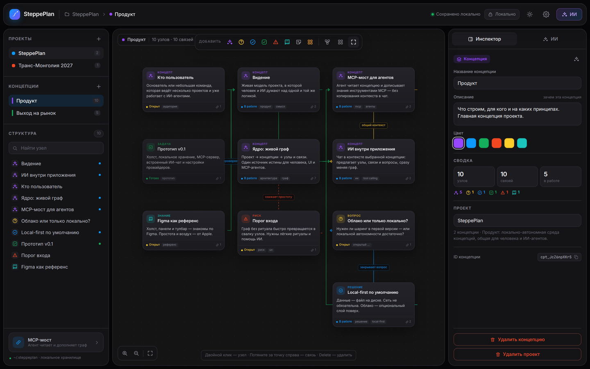
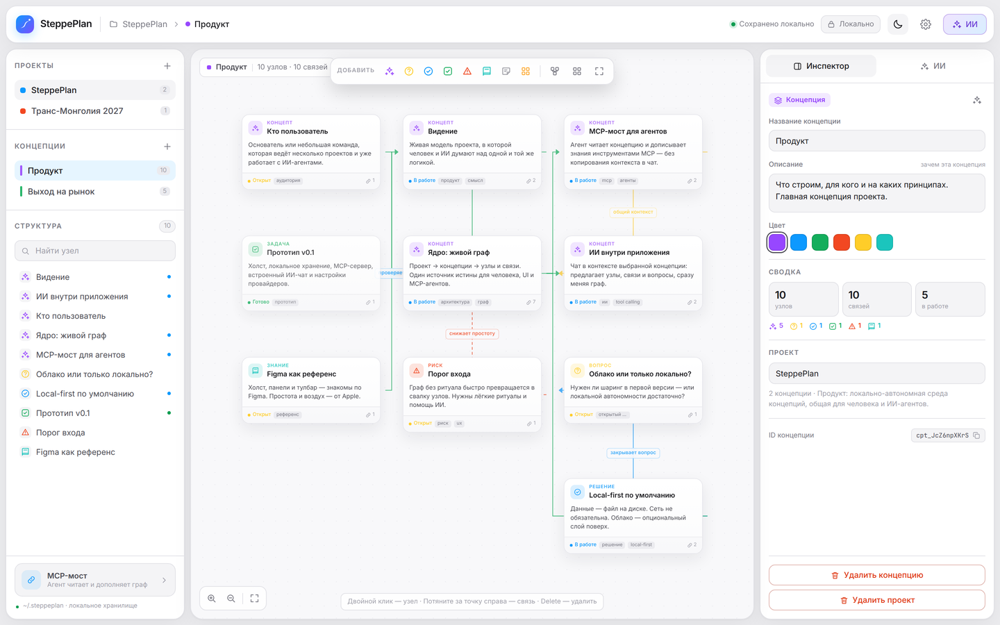
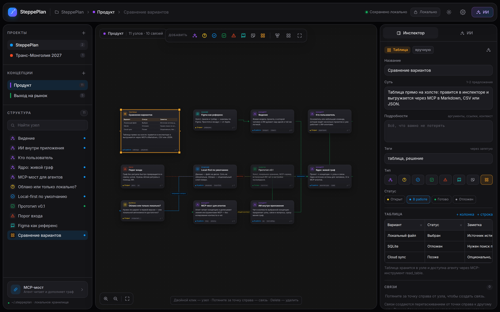
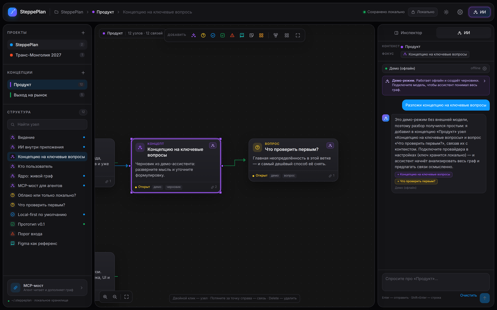
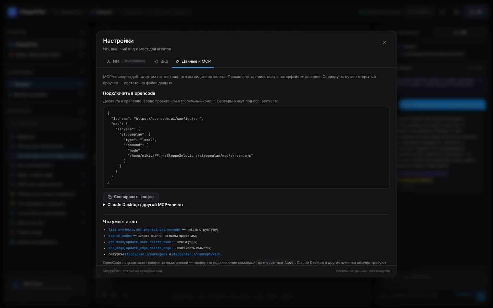

# SteppePlan

**Граф концепции, в котором человек и ИИ думают над одной логикой.**

[](release/latest.json)
[](LICENSE)
[](docs/UPDATES.md)
[](#как-это-устроено)

SteppePlan — настольное приложение для проектных концепций. Вы раскладываете идею узлами и связями: что строим, для кого, что уже решено, что под вопросом. Получается не документ, а живая карта смысла, которую удобно читать глазами и машиной.

Главное — тот же граф доступен ИИ-агенту через MCP. Claude, opencode или Cursor читают концепцию, дописывают узлы и связи, а правки сразу появляются на холсте. Встроенный чат умеет то же самое: OpenAI, DeepSeek, OpenRouter, Ollama, Anthropic — или офлайн-демо без ключа.

## Скачать

**Linux x86_64 · 0.1.8** · [steppeplan-0.1.8-linux-x86_64.tar.gz](release/steppeplan-0.1.8-linux-x86_64.tar.gz?raw=true) · 48 МБ · [SHA-256](release/SHA256SUMS)

```bash
tar -xzf steppeplan-0.1.8-linux-x86_64.tar.gz
cd steppeplan-0.1.8-linux-x86_64
./install.sh
steppeplan
```

Установщик кладёт приложение в `~/.local/share/steppeplan` и создаёт команды `steppeplan`, `steppeplan-mcp`, `steppeplan-update`, `steppeplan-rollback`. Данные остаются в `~/.steppeplan` и переживают обновления.

Других сборок пока нет. Веб-версия запускается из исходников.

## Из исходников

Нужен Node.js 20.19+.

```bash
npm install
npm start        # сборка UI и запуск на http://127.0.0.1:8787
npm run dev      # разработка с HMR, UI на http://127.0.0.1:5173
```

Данные лежат в `~/.steppeplan/workspace.json`. Другой каталог можно указать через `STEPPEPLAN_HOME`.

## Что умеет

- **Проекты → концепции → граф.** В одном проекте несколько концепций; в каждой — свои узлы и связи.
- **Восемь типов узлов:** концепт, вопрос, решение, задача, риск, знание, заметка, таблица. Пять типов связей: поддерживает, зависит, уточняет, противоречит, связано.
- **Холст в духе Figma:** перетаскивание, изменение размера карточек, ортогональные связи, ручное разведение линий, две авто-раскладки, поиск, миникарта, тёмная и светлая темы.
- **Таблицы прямо на карточке:** редактируются в инспекторе и выгружаются агенту в Markdown, CSV или JSON.
- **MCP-сервер:** 13 инструментов для чтения и правки графа плюс ресурсы с рабочим пространством и концепциями. Работает поверх того же файла, что и интерфейс.
- **ИИ-чат с tool calling:** видит выбранную концепцию, создаёт узлы и связи, умеет работать офлайн в демо-режиме.
- **Local-first:** сеть не обязательна, аккаунта нет, ключи провайдеров хранятся отдельно от данных.

## Скриншоты

| Тёмная тема | Светлая тема |
| --- | --- |
|  |  |

| Таблица на карточке | ИИ-ассистент |
| --- | --- |
|  |  |



## MCP

Добавьте сервер в конфиг клиента. Для opencode — `opencode.json` в проекте или глобальный конфиг (формат V2, серверы под `mcp.servers`):

```json
{
  "$schema": "https://opencode.ai/config.json",
  "mcp": {
    "servers": {
      "steppeplan": {
        "type": "local",
        "command": ["node", "/путь/к/steppeplan/mcp/server.mjs"]
      }
    }
  }
}
```

В desktop-сборке есть готовая обёртка `steppeplan-mcp`, поэтому достаточно `"command": ["steppeplan-mcp"]`.

Агент получает 13 инструментов: `list_projects`, `get_project`, `get_concept`, `search_nodes`, `create_project`, `create_concept`, `add_node`, `update_node`, `delete_node`, `add_edge`, `update_edge`, `delete_edge`, `read_table`. Плюс ресурсы `steppeplan://workspace` и `steppeplan://concept/<id>`. Подробности — в [контракте MCP](docs/MCP.md).

## Как это устроено

```text
src/        React + TypeScript: холст, панели, инспектор, чат
server/     локальный HTTP API, SSE, файловый store, прокси ИИ
mcp/        MCP-сервер (stdio) поверх того же store
desktop/    Tauri-оболочка, установщик и обновления
scripts/    smoke-тесты, сборка релиза, заметки через MCP
docs/       архитектура, MCP, обновления, роадмап
```

Один JSON-файл — источник истины для интерфейса и агентов. Любая мутация увеличивает `revision`, UI получает её по SSE. Секреты провайдеров лежат в `secrets.json` и никогда не попадают в API-ответы или MCP.

Стек: React, `@xyflow/react`, Zustand, Vite; Node.js без фреймворка; официальный MCP SDK; Tauri для настольной сборки. Приложение намеренно разделено на webview и локальный демон, чтобы позже перенести ядро на Rust.

## Документация

- [Архитектура](docs/ARCHITECTURE.md)
- [Контракт MCP](docs/MCP.md)
- [Сборка и обновления Linux](docs/UPDATES.md)
- [Роадмап](docs/ROADMAP.md)
- [Контекст для разработки](AGENTS.md)

## Ограничения

Проект ранний: версия 0.1.x. Пока нет облака, совместного доступа, аккаунтов и истории версий. Настольная сборка только для Linux x86_64. Локальный сервер слушает `127.0.0.1` и не требует пароля — это личный инструмент, а не сетевой сервис.

## Участие

Issues и pull requests приветствуются. Перед PR:

```bash
npm run typecheck
npm run test:mcp
npm run test:ai
npm run build
```

## Лицензия

[MIT](LICENSE). Делайте что хотите, только сохраните уведомление об авторстве.
